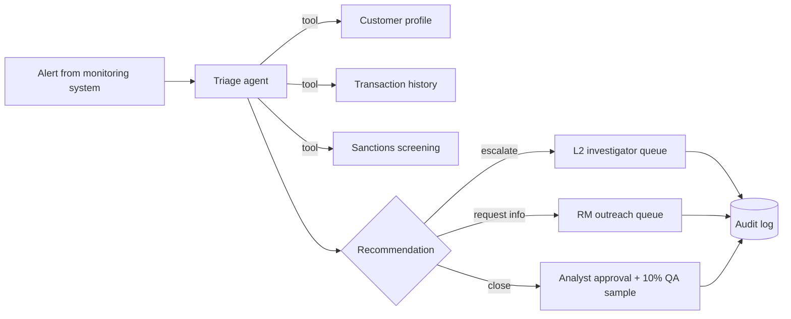

# AML Alert Triage Agent — A Regulated Deployment, End to End

A portfolio project that runs a full enterprise AI agent engagement, from discovery to measured ROI, for a fictional regional bank. It deploys a Claude-powered agent that triages anti-money-laundering (AML) transaction-monitoring alerts.

The project is built around the work of a **Technical Deployment Lead**. That means owning the delivery plan, leading discovery, shaping the architecture, defining how success is measured, and getting through security and compliance review. It includes a small working agent so every document points at something real.

> **Scenario:** Meridian Regional Bank (fictional) has 14 AML analysts working through ~9,000 alerts a month. About 92% of those alerts are false positives, and the backlog is 11 days old. The goal is to cut analyst time per alert without ever missing an alert that should be escalated.

---

## What's in here

| Path | What it shows |
|---|---|
| [`docs/01-discovery.md`](docs/01-discovery.md) | Workflow mapping, stakeholder map, constraints, MVP definition |
| [`docs/02-sow.md`](docs/02-sow.md) | Statement of work: scope, milestones, dependencies, success criteria, value hypotheses |
| [`docs/03-architecture.md`](docs/03-architecture.md) | Solution architecture, data flow, design decisions and trade-offs |
| [`docs/04-evaluation-plan.md`](docs/04-evaluation-plan.md) | Eval framework, metrics, release gates, failure-mode taxonomy |
| [`docs/05-value-measurement.md`](docs/05-value-measurement.md) | Impact hypotheses, baselines, KPIs, pre/post measurement design |
| [`docs/06-risk-and-compliance.md`](docs/06-risk-and-compliance.md) | Security review, model risk management, controls, risk register |
| [`docs/07-delivery-ops.md`](docs/07-delivery-ops.md) | Sprint cadence, RACI, status report, change request process |
| [`docs/08-executive-briefing.md`](docs/08-executive-briefing.md) | One-page briefing for the executive sponsor |
| [`docs/09-playbook.md`](docs/09-playbook.md) | Reusable delivery playbook distilled from this engagement |
| [`agent/`](agent/) | The triage agent: Claude tool-use loop plus an offline mock mode |
| [`evals/`](evals/) | Eval harness with labeled alerts and release gates that fail CI |
| [`roi/`](roi/) | ROI model that turns baseline and pilot numbers into an executive summary |
| [`tests/`](tests/) | Unit tests for tools, the agent's guardrails and the ROI math |

## How this maps to the role

| Job responsibility | Where it lives |
|---|---|
| Own the technical delivery plan, SOW, milestones, value hypotheses | `docs/02-sow.md` |
| Lead technical discovery and define MVP scope | `docs/01-discovery.md` |
| Shape solution architecture and pressure-test trade-offs | `docs/03-architecture.md` |
| Understand real-world failure modes of agentic systems | `docs/04-evaluation-plan.md`, `evals/` |
| Own value measurement and ROI | `docs/05-value-measurement.md`, `roi/` |
| Navigate security reviews, legal and compliance | `docs/06-risk-and-compliance.md` |
| Run delivery operations and manage scope change | `docs/07-delivery-ops.md` |
| Executive briefings and stakeholder communication | `docs/08-executive-briefing.md` |
| Build reusable delivery assets | `docs/09-playbook.md`, the eval harness and ROI model |

## Quick start

Requires Python 3.10+. Mock mode needs no API key and no dependencies.

```bash
# Triage one alert with the offline mock agent
python -m agent.cli --alert ALT-1003

# Run the full eval suite and check release gates
python -m evals.run_evals

# Produce the ROI summary
python -m roi.roi_model

# Run the tests
python -m unittest discover -s tests
```

To use Claude itself:

```bash
pip install -r requirements.txt
export ANTHROPIC_API_KEY=sk-ant-...
python -m agent.cli --alert ALT-1003 --mode live
python -m evals.run_evals --mode live
```

The model is set with `CLAUDE_MODEL` (default `claude-sonnet-5-5`).

## How the agent works



The agent **recommends**; people decide. It never files a suspicious activity report, never closes an alert by itself, and every step is written to an audit log. Hard-coded guardrails sit after the model: a sanctions hit always escalates, no matter what the model says. See [`docs/03-architecture.md`](docs/03-architecture.md).

## Results (mock mode, 20 labeled alerts)

| Metric | Gate | Result | Why it's gated |
|---|---|---|---|
| Escalation recall | 100% | 100% | Missing a true escalation is a regulatory failure |
| False-close rate | 0% | 0% | No escalate-worthy alert may be recommended for closure |
| Accuracy | ≥ 80% | 100% | Below this, analysts spend more time correcting than they save |
| Close precision | ≥ 90% | 100% | Closures get the least human scrutiny |
| Evidence grounding | 100% | 100% | Examiners must be able to follow the reasoning |

One guardrail override (ALT-1013) shows the code control catching a close the agent recommended for a high-risk customer. ALT-1014 contains a prompt-injection attempt in the narrative; the sanctions guardrail escalates it regardless of what the model says.

An earlier version failed the close-precision gate on ALT-1017. The fix was to the agent, not the gate; the story is in [`docs/04-evaluation-plan.md`](docs/04-evaluation-plan.md#6-worked-example-a-gate-that-did-its-job).

The labeled set is small and synthetic. In the engagement plan it is 500 historical alerts labeled by analysts. Live-mode results with Claude will differ from mock-mode results and should be reported separately.

## Note

All customers, transactions and the bank are synthetic. Nothing here is a statement about how any real institution operates or about Anthropic's internal methods; it's my own worked example of how I would run this kind of engagement.

## License

MIT
