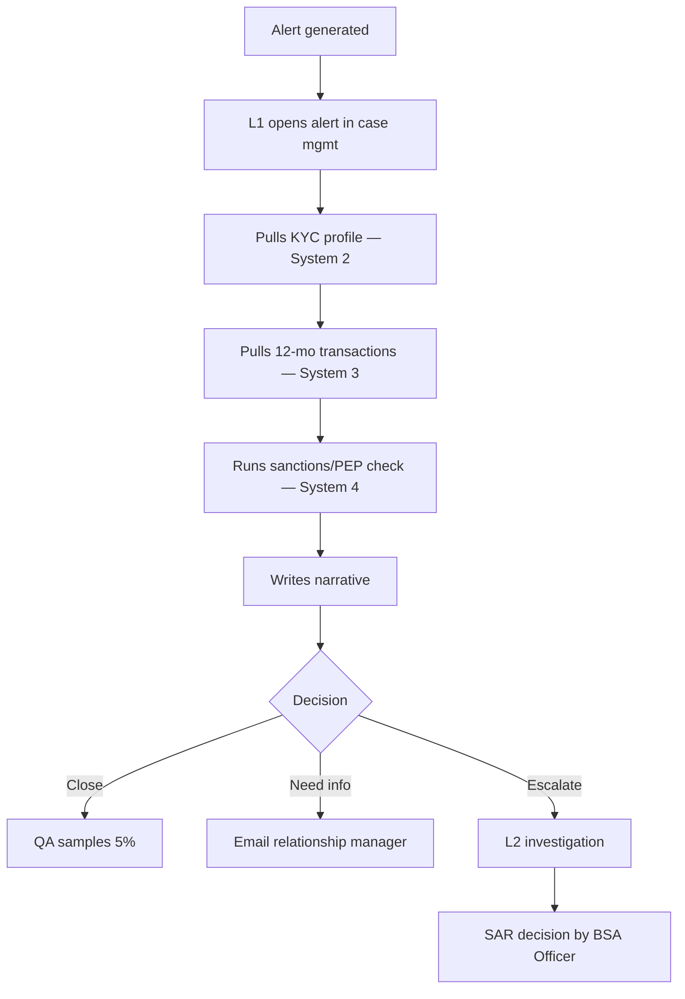

# 01 — Technical Discovery

**Engagement:** AML Alert Triage Agent · Meridian Regional Bank (fictional)
**Discovery window:** 2 weeks · 9 interviews · 3 shadowing sessions · 1 data walkthrough

## 1. Business problem

Meridian's transaction-monitoring system generates ~9,000 alerts a month. Each one is reviewed by a Level 1 (L1) analyst, who decides to close it, request more information, or escalate to a Level 2 (L2) investigator.

| Observed | Value | Source |
|---|---|---|
| Alerts per month | ~9,000 | Monitoring system export, last 6 months |
| False-positive rate (closed at L1) | ~92% | Case management system |
| Median L1 handle time | 22 min | Time-in-state data + shadowing |
| Backlog age | 11 days | Ops dashboard |
| L1 analysts | 14 FTE | HR / Ops lead |
| Regulator finding on timeliness | 1 open (MRA) | Chief Compliance Officer |

**The real problem is not "too many alerts."** Shadowing showed analysts spend about 70% of handle time *gathering* context (opening four systems, copying data into a narrative) and about 30% *judging*. That gathering work is where an agent helps most, and it carries the least risk.

## 2. Current workflow

**Pain points found:**
1. Four separate systems; no single view of the customer.
2. Narrative quality varies a lot by analyst; QA rejects 8% for missing evidence.
3. "Need info" requests to relationship managers sit for 4.5 days on average.
4. Analysts can't see prior alerts on the same customer without a separate search.

## 3. Stakeholder map

| Stakeholder | Role in engagement | Primary concern | What they need from us |
|---|---|---|---|
| Chief Compliance Officer | Executive sponsor | Clearing the MRA; exam readiness | Monthly ROI and risk read-out |
| BSA/AML Officer | Business owner, final decision-maker on SARs | Never missing a true positive | Recall evidence; veto on release |
| Head of FIU Operations | Day-to-day owner | Backlog and analyst capacity | Throughput and handle-time KPIs |
| Model Risk Management (MRM) | Independent validator | SR 11-7 compliance | Model documentation, eval results, monitoring plan |
| CISO / InfoSec | Approver | Data leaving the network, access control | Data flow diagram, vendor security pack |
| Enterprise Architecture | Approver | Integration patterns, ownership | Architecture doc, runbook |
| Legal / Privacy | Approver | Customer data handling, retention | DPA review, retention policy |
| Procurement | Approver | Contract terms | SOW, pricing, change process |
| L1 Analysts (3 reps) | Users | "Will this replace me?" "Can I trust it?" | Involvement in evals; agent explains itself |

## 4. Constraints

**Regulatory**
- Bank Secrecy Act: the decision to file a SAR stays with a human (the BSA Officer).
- SR 11-7 / OCC 2011-12: the agent counts as a model; it needs validation, documentation and ongoing monitoring.
- Records must be kept for 5 years with a full audit trail.

**Technical**
- Core systems sit on-premises; case management has a REST API, the KYC system has only a nightly batch export.
- No customer PII may be stored by the vendor beyond processing; zero-data-retention terms are required.
- All model calls must go through the bank's API gateway for logging.

**Organizational**
- Analyst union agreement requires 60-day notice for workflow changes affecting headcount; the pilot frames the agent as assistive.
- MRM validation queue is ~6 weeks; it is on the critical path.

## 5. What we will *not* do (and why)

| Out of scope | Reason |
|---|---|
| Auto-closing alerts | Unacceptable regulatory risk for a first deployment; revisit after 6 months of data |
| Tuning the monitoring rules | Separate model owned by a different team; noted as a phase 2 opportunity |
| L2 investigation support | Different workflow and users; keep the pilot focused |
| SAR narrative drafting | Highest scrutiny document; requires its own validation |

## 6. MVP definition

**One sentence:** For L1 alerts from the three highest-volume rules, the agent assembles the evidence, recommends close / request-info / escalate with a cited rationale, and an analyst approves or overrides it in the existing case management screen.

| Must have | Should have | Later |
|---|---|---|
| Tools: KYC profile, transaction history, sanctions screen | Prior-alert history tool | Auto-draft RM outreach emails |
| Structured recommendation with evidence citations | Confidence score shown to analyst | L2 support |
| Deterministic guardrails (sanctions → escalate) | Override reason capture | Rule-tuning feedback loop |
| Full audit log | Analyst feedback button | |
| Eval suite with release gates | | |

## 7. Open questions carried into the SOW

1. Can the KYC batch export move to near-real-time? (Owner: Enterprise Architecture; dependency D2.)
2. Will MRM accept a staged validation, pilot first then full? (Owner: MRM lead; risk R3.)
3. Who owns the agent after handover: FIU Ops or a central AI platform team? (Owner: CCO.)
