# 02 — Statement of Work

**Engagement:** AML Alert Triage Agent — Pilot
**Customer:** Meridian Regional Bank (fictional)
**Duration:** 14 weeks (2 discovery + 10 build/validate + 2 pilot read-out)
**Team:** Technical Deployment Lead (1), Forward Deployed Engineers (2), Customer engineering (2), Customer SMEs (3 analysts, 0.25 FTE each)

## 1. Objective

Reduce L1 analyst handle time on AML alerts by at least 40% for the three highest-volume monitoring rules, with zero missed escalations, measured over a 4-week controlled pilot.

## 2. Value hypotheses

Each hypothesis has a metric, a baseline and a threshold. If a threshold isn't met, we say so in the read-out.

| # | Hypothesis | Metric | Baseline | Target |
|---|---|---|---|---|
| H1 | Automating evidence gathering cuts handle time | Median L1 handle time | 22 min | ≤ 13 min |
| H2 | The agent does not reduce detection quality | Escalation recall on labeled set + pilot QA | 100% (by definition) | 100% |
| H3 | Standardized cited narratives improve quality | QA rejection rate | 8% | ≤ 3% |
| H4 | Faster triage clears the backlog | Backlog age | 11 days | ≤ 3 days by week 4 of pilot |
| H5 | Analysts will use it | Recommendations accepted without edit | n/a | ≥ 70% |

## 3. Scope

**In scope**
- Agent for L1 triage of alerts from rules R-101 (high-value wire), R-204 (cash structuring) and R-317 (high-risk geography). These are 64% of volume.
- Three read-only tools: KYC profile, 12-month transaction summary, sanctions/PEP screening.
- Integration into the existing case management UI as a side panel (customer engineering builds the UI; FDEs build the agent service).
- Eval suite, release gates, monitoring dashboard, audit logging.
- Model documentation package for Model Risk Management.
- Runbook and handover to the named owner.

**Out of scope** — see `01-discovery.md §5`. Changes go through the change process in `07-delivery-ops.md`.

## 4. Milestones

| # | Milestone | Week | Exit criteria | Owner |
|---|---|---|---|---|
| M0 | Discovery complete | 2 | Signed SOW; baselines captured; data access granted | TDL |
| M1 | Labeled eval set ready | 4 | 500 historical alerts labeled by 2 analysts; disagreements adjudicated by BSA Officer | TDL + SMEs |
| M2 | Agent v1 passes offline gates | 7 | All release gates green on labeled set | FDE lead |
| M3 | Security & architecture approval | 8 | InfoSec sign-off; EA sign-off | TDL |
| M4 | MRM validation complete | 10 | MRM memo approving pilot use | MRM (dependency) |
| M5 | Shadow mode | 10–11 | Agent runs on live alerts; analysts don't see output; results compared | FDE lead |
| M6 | Controlled pilot | 11–14 | 6 analysts use agent; 8 control analysts don't | Head of FIU Ops |
| M7 | Pilot read-out | 14 | ROI report and go/no-go recommendation to CCO | TDL |

```mermaid
gantt
    dateFormat  X
    axisFormat  W%s
    section Discovery
    Discovery & SOW        :0, 2
    section Build
    Eval set labeling      :2, 4
    Agent build            :2, 7
    Security & EA review   :5, 8
    MRM validation         :6, 10
    section Pilot
    Shadow mode            :10, 11
    Controlled pilot       :11, 14
    Read-out               :milestone, 14, 0
```

## 5. Dependencies

| # | Dependency | Needed by | Owner | Status |
|---|---|---|---|---|
| D1 | Read-only API credentials for case management | Week 3 | Customer IT | Requested |
| D2 | KYC data refresh more often than nightly | Week 6 | Enterprise Architecture | At risk: fallback is nightly data with staleness flag |
| D3 | Analyst time for labeling (3 × 0.25 FTE) | Weeks 2–4 | Head of FIU Ops | Committed |
| D4 | MRM validation slot | Week 6 | MRM | Booked |
| D5 | Zero-data-retention terms in contract | Week 5 | Procurement / Legal | In review |

## 6. Success criteria for go/no-go

**Go** to production rollout if all are true:
1. Escalation recall = 100% on the labeled set *and* no missed escalations found in pilot QA.
2. Median handle time in the treatment group ≥ 40% lower than control.
3. MRM has no open findings rated "high."
4. Acceptance-without-edit rate ≥ 60% (the floor; target 70%).

**No-go or extend** if recall is below 100% or MRM raises a high finding. The fallback plan is to keep shadow mode and fix the failure mode, not to tune the gate.

## 7. Assumptions

- Historical alert outcomes are a reasonable ground truth once adjudicated (we know ~3% of past closures were later reopened; those are relabeled).
- The case management vendor allows a side-panel integration without a major version upgrade.
- Pilot alert mix matches the historical mix within ±10% per rule.

## 8. Acceptance

Each milestone is accepted in writing by the Head of FIU Ops; M4 and M7 also need the BSA Officer.
