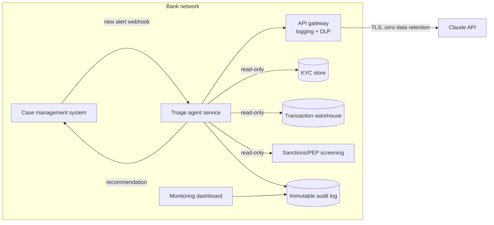

# 03 — Solution Architecture

## 1. Overview



The agent service is a small, stateless Python service. It receives an alert, runs a tool-use loop with Claude, applies deterministic guardrails to the result, writes everything to the audit log, and posts a recommendation back to case management. An analyst always makes the decision.

## 2. Agent design

**Loop:** Claude gets the alert and a system prompt with the bank's triage policy. It calls tools to gather evidence, then must call `submit_recommendation` with a fixed schema. Max 8 turns; if it hits the limit, the alert is routed to a human with "agent could not complete."

**Tools** (all read-only):

| Tool | Returns | Why read-only matters |
|---|---|---|
| `get_customer_profile` | Segment, risk rating, expected activity, occupation | Agent can't change KYC records |
| `get_transaction_history` | 12-month summary, prior alerts | No write path to the ledger |
| `screen_sanctions` | Match / no match with score | Screening logic stays in the bank's certified system |
| `submit_recommendation` | — (terminal) | Forces structured output |

**Output schema:**
```json
{
  "recommendation": "escalate | request_info | close",
  "risk_score": 0-100,
  "rationale": "string, 2–5 sentences",
  "evidence": ["each item cites a tool result"],
  "requires_human_review": true
}
```

## 3. Guardrails (applied after the model, in code)

The model is good at synthesis. It is not the control. These rules run on every output and can only make a recommendation *more* cautious:

1. **Sanctions hit → escalate.** Overrides any model recommendation.
2. **High-risk customer can't be closed.** A `close` for a customer rated high risk becomes `request_info`.
3. **No evidence, no recommendation.** An empty evidence list becomes `request_info`.
4. **Schema failure → human.** Malformed output is never parsed loosely; it's routed to an analyst.
5. **`requires_human_review` is always true** in the pilot. The field exists so it can be relaxed later, deliberately.

Every override is logged with the rule that fired, so MRM can see how often the model needed correcting.

## 4. Design decisions

| Decision | Options considered | Chosen | Trade-off accepted |
|---|---|---|---|
| Recommend vs. act | Auto-close low-risk / recommend only | **Recommend only** | Smaller time savings in exchange for regulator and MRM comfort; revisit with 6 months of data |
| Controls location | Prompt-only / code guardrails | **Code guardrails after the model** | More code to maintain; but controls are testable and don't depend on model behavior |
| Data freshness | Real-time KYC API / nightly batch | **Nightly batch + staleness flag** (D2 at risk) | Agent may see 1-day-old KYC; flagged in output and acceptable for L1 |
| Context strategy | Send full 12-mo transactions / summarized | **Summarized by tool** | Model can't spot every pattern itself, but tokens and PII exposure drop sharply |
| Single vs. multi-agent | Orchestrator + specialists / one agent | **One agent, three tools** | Simpler to validate; MRM reviews one model, not a system of them |
| Model choice | Largest model / mid-tier | **Mid-tier (configurable)** | Re-run evals on any model change; switching is a config change plus a gate run |

## 5. Failure modes and handling

| Failure | Detection | Handling |
|---|---|---|
| API timeout / outage | Gateway error | Alert falls back to the normal manual queue; no SLA impact |
| Hallucinated evidence (cites data no tool returned) | Evidence-grounding check in evals; spot QA in prod | Release gate; pilot QA samples 10% of all recommendations |
| Prompt injection via alert narrative text | Narrative is passed as data in a tagged block; tools are read-only | Worst case is a bad recommendation, which guardrails and human review catch |
| Drift in alert mix | Weekly distribution check vs. eval set | Re-label sample and re-run gates if any rule's share moves > 10% |
| Stale KYC | Staleness flag from tool | Shown to analyst; agent instructed to request info if profile > 30 days old |

## 6. Non-functional requirements

| Requirement | Target |
|---|---|
| Latency (p95, alert to recommendation) | < 60 s; it runs asynchronously when the alert is created |
| Availability | Best effort; manual process is the fallback |
| Audit retention | 5 years, write-once storage |
| Access | Service account with read-only scopes; no analyst credentials used |
| Cost | Tracked per alert; target < $0.15 per alert |
