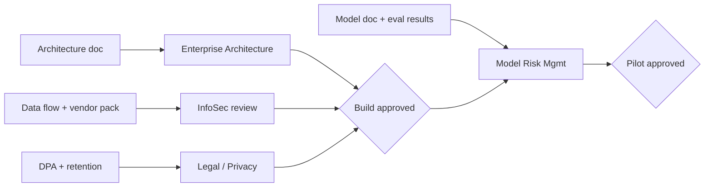

# 06 — Risk, Security & Compliance

## 1. Approval path

Starting all four reviews in week 5, in parallel, keeps MRM (6 weeks) off the critical path as much as possible.

## 2. Security review pack

| Question InfoSec will ask | Answer / artifact |
|---|---|
| What data leaves the network? | Alert fields, summarized KYC and transaction data for one customer per call. No full account numbers (masked to last 4), no SSNs. Data flow diagram in `03-architecture.md`. |
| Is it retained by the vendor? | Zero-data-retention terms in contract (D5). |
| How is it transmitted? | TLS 1.2+ via the bank's API gateway, which logs and runs DLP. |
| Can the agent change data? | No. All tools are read-only; the service account has no write scopes. |
| Prompt injection? | Narrative text is treated as untrusted data; no tools with side effects exist; guardrails and human review sit downstream. |
| Who can change the prompt or model? | Changes through the bank's change management; every change must pass eval gates in CI. |

## 3. Model risk management (SR 11-7)

| SR 11-7 element | How we address it |
|---|---|
| Model definition and purpose | Model doc: assists L1 triage; does not decide; does not file SARs |
| Conceptual soundness | Policy prompt maps to the bank's written triage procedures; code guardrails documented |
| Data quality | Labeled set provenance, inter-rater agreement, staleness handling |
| Outcomes analysis | Eval suite with gates; shadow mode comparison; pilot QA |
| Ongoing monitoring | Weekly drift check, override rate trend, QA sample, quarterly re-validation |
| Limitations | Recommends only; three rules only; English narratives only; nightly KYC |
| Change management | Model version, prompt version and tool schemas pinned; any change re-runs gates |

## 4. Risk register

| ID | Risk | Likelihood | Impact | Mitigation | Owner |
|---|---|---|---|---|---|
| R1 | Agent misses a true escalation | Low | Critical | 100% recall gate; sanctions guardrail; human decides; 10% QA | TDL / BSA Officer |
| R2 | Analysts over-trust the agent (automation bias) | Medium | High | Show evidence, not just verdict; track acceptance rate vs. QA outcomes; training | FIU Ops |
| R3 | MRM validation slips past week 10 | Medium | High | Early engagement; staged validation proposal; shadow mode can start pre-approval | TDL |
| R4 | KYC near-real-time feed not ready (D2) | High | Medium | Nightly batch + staleness flag | Enterprise Arch |
| R5 | Analyst resistance | Medium | Medium | Analysts help label evals; "capacity" framing; override reasons acted on visibly | FIU Ops |
| R6 | Model or API change alters behavior | Low | High | Pin model version; gate run on any change | FDE lead |
| R7 | Scope creep into L2 / SAR drafting | Medium | Medium | Change process; parked in phase 2 backlog | TDL |

## 5. Escalation path

Issue at the working level → TDL (same day) → Head of FIU Ops + Anthropic engagement lead (48 h) → CCO steering committee (weekly). Any suspected missed escalation in pilot goes straight to the BSA Officer and pauses the pilot for that rule until root-caused.
